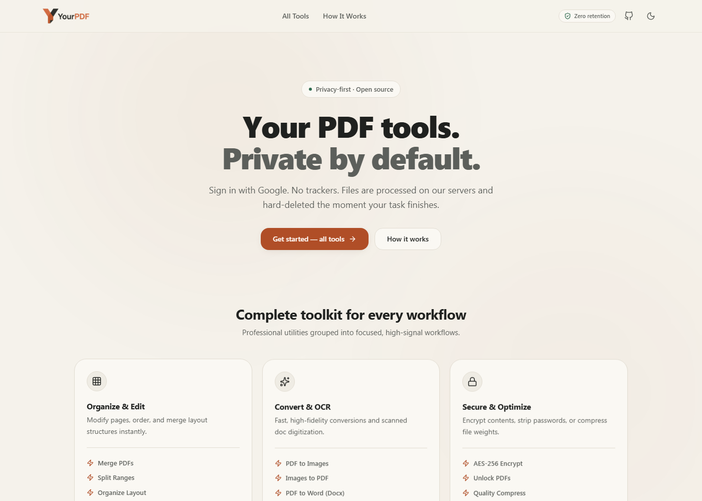
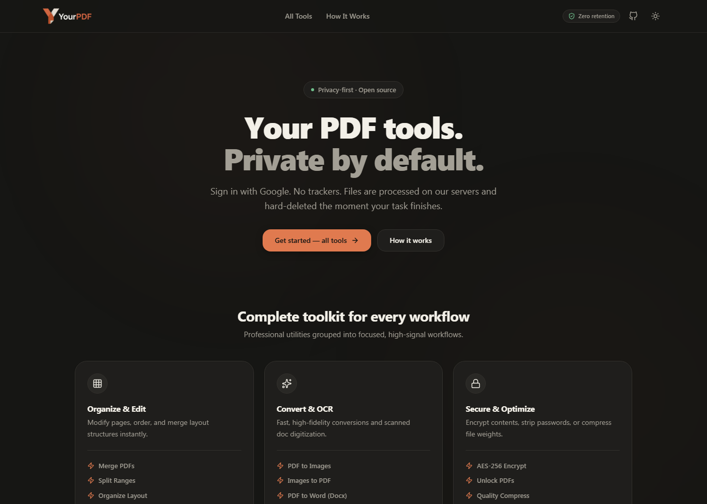
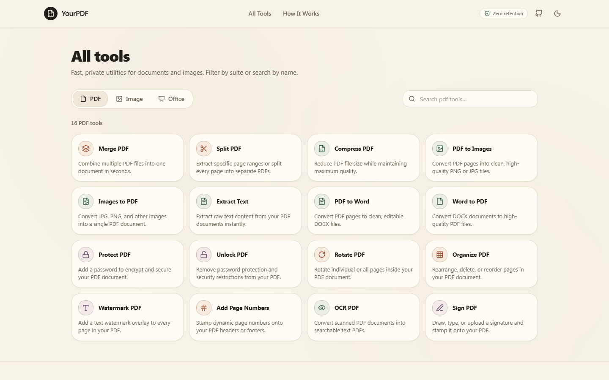
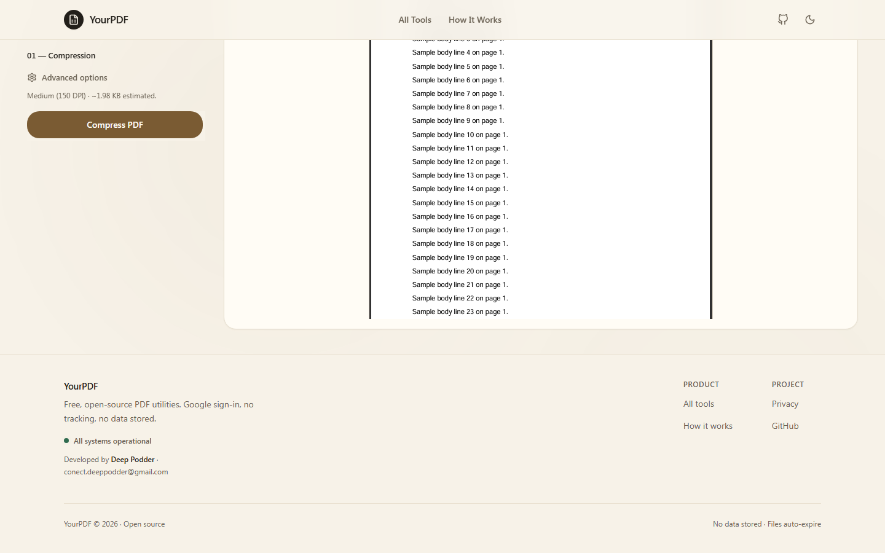
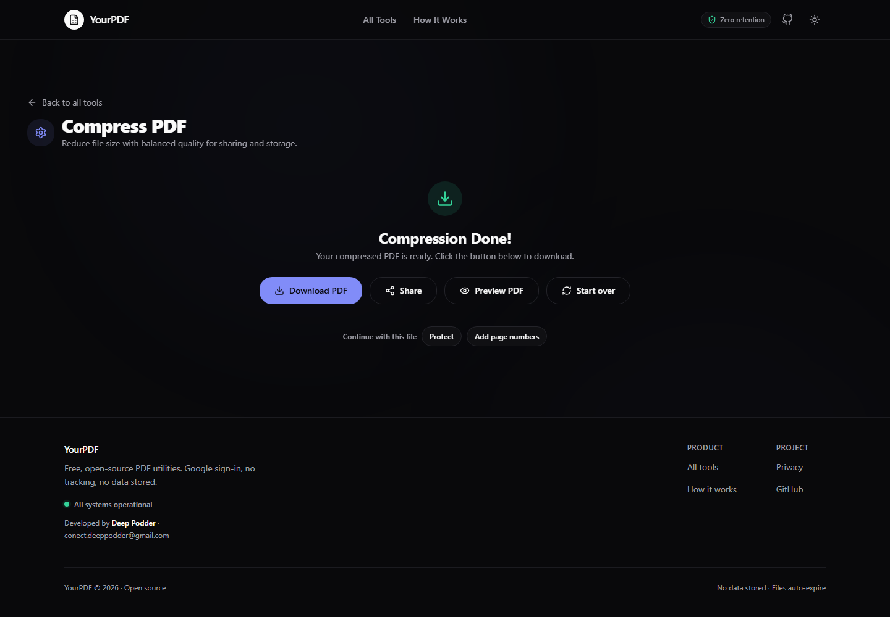
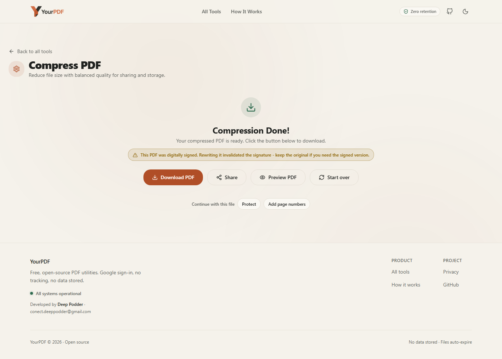
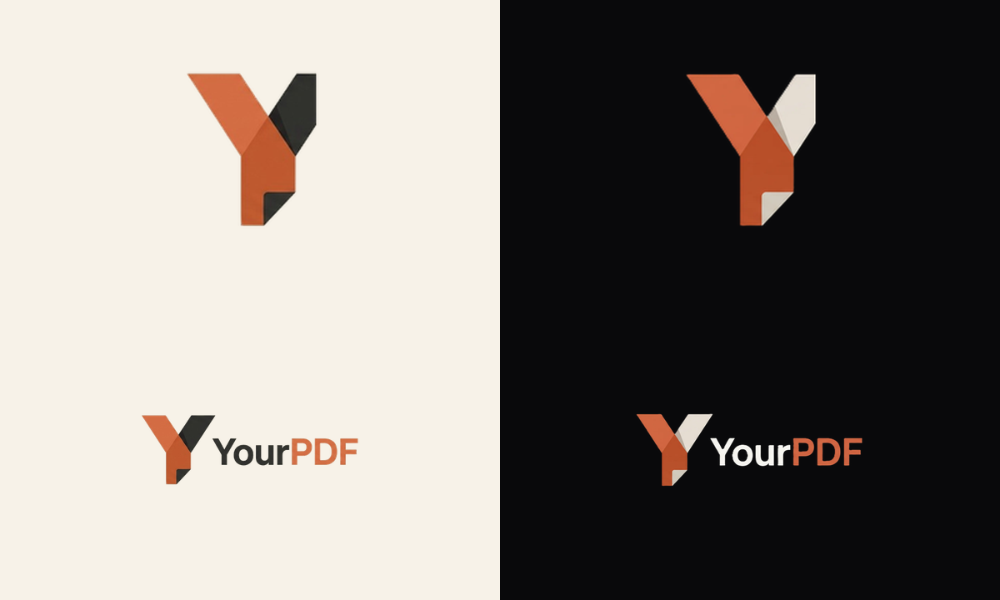

# UI notes

Short record of the interface decisions that are easy to undo by accident. Each section links the
render it was verified against.

## Colour: terracotta as a 5% signal, not a surface

The brand mark is terracotta, so the accent follows it — but the exact brand hex cannot fill a
button: `#D46537` measures **3.67:1** against white text, below the 4.5:1 our 14 px CTA needs.
The accent therefore has two jobs:

| Token | Value (light) | Role |
| --- | --- | --- |
| `--accent` | `#B04E27` | fills and text: 5.30:1 with white, 4.74:1 on the canvas |
| `--accent-signal` | `#D46537` | borders, focus rings, tints — non-text only, 3.29:1 |
| `--ring` | `var(--accent-signal)` | solid, because a 70% tint measures 2.28:1 |

Dark mode lifts the accent to `#E07A4F` (6.10:1) on a warm espresso canvas (`#161614`) rather than
cold slate, because orange looks accidental against blue-greys. Errors moved to crimson `#B3261E`
so "problem" never reads as "brand".

## One primary action per screen

Exactly one accent-filled button per view. Secondary actions (Replace, Start over, Preview) stay
neutral. On the marketing page the nav "Source" button was demoted to secondary so the hero CTA is
the only brand fill above the fold.

## Density: the tool directory

Three columns pushed the last card to **1017 px** — below the 900 px fold. Four columns with the
icon on the title's line (157 px → 114 px per card) puts all 16 tools at **809 px**, no scrolling.
Cards are tinted by intent: amber = organise, sage = convert, plum = security.

## Sticky controls

A long preview must not scroll the controls out of reach, so the settings column is sticky on
desktop with its own scrollport and `overscroll-behavior: contain`. Verified in a browser: the
column held at `top: 80px` after scrolling 454 px.

## Result state: hand-off, not a dead end

The done screen offers the download, Web Share (where the platform can share files), and
"continue with this file" chaining into Compress / Protect / Add page numbers, carried across the
navigation by IndexedDB rather than a re-upload.

## Warnings, not blocks

Rewriting a digitally signed PDF invalidates its signature. Refusing would block legitimate work,
so the response carries `X-Job-Notice` and the result screen shows it in amber — the download is
still offered.

## Brand assets

Light and dark lockups are separate files, not a tinted one: the mark's black arm and the wordmark
ink are part of the design. The favicon swaps from the app's own theme state (an OS media query
cannot follow an in-app toggle). Sources live in `brand-source/`.

